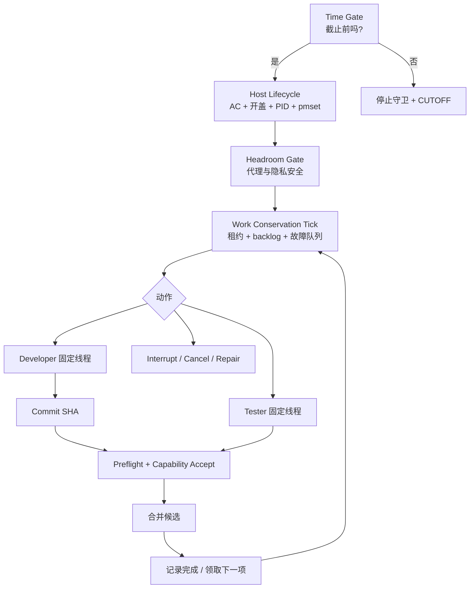
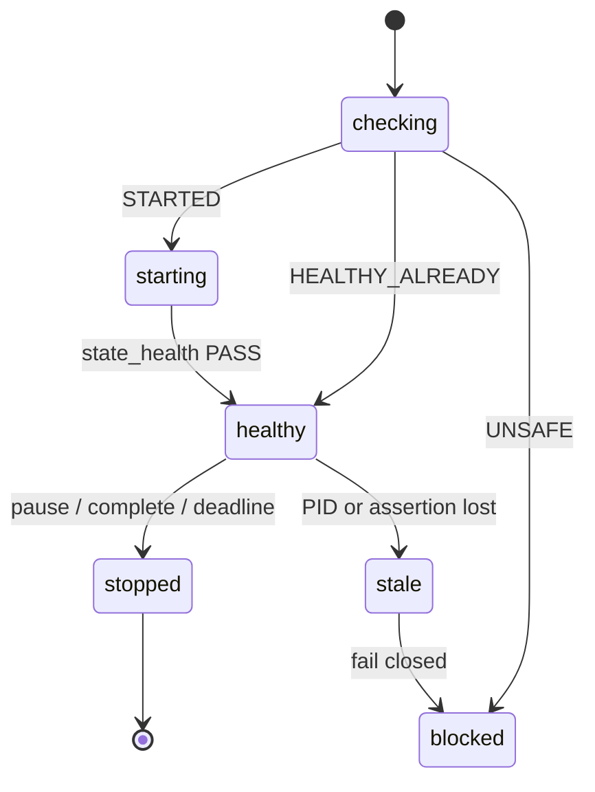

# Looped Vows 持续运行与自愈方案

> 副标题：从“自动化已安排”到“可验证的持续有效工作”
>
> 版本：1.0
> 最后实机验证：2026-10-25 JST
> 状态：已实现、已接入强制门禁、已通过真实宿主机验证
> 适用对象：需要连续运行数小时至数天的本地 Agent 产品化、开发和 GUI 验收流水线

---

## 0. 如何阅读本文

这份文档不是某一段脚本的说明书，而是一套可迁移的运行方法论。

建议按以下顺序学习：

1. 先读第 1～3 节，理解为什么“自动化存在”“线程 inProgress”“客户端进程存在”都不等于有效工作。
2. 再读第 4～8 节，掌握宿主机守卫、工作守恒、能力门禁和客户端救援四层机制。
3. 然后读第 9～11 节，按端到端流程和 Runbook 实际运行一次。
4. 最后用第 12～16 节排查故障、检查安全边界、复现实机验收，并迁移到其他项目。

方案的目标不是让界面一直显示“运行中”，而是保证：

```text
宿主机可执行 + 任务有显式进展 + 等待有上限 + 故障可隔离 + 到点可收口
```

---

## 1. 方案摘要

长任务失去吞吐，通常不是单个大模型推理慢，而是四类故障叠加：

| 故障层 | 典型假健康信号 | 真实问题 | 对应方案 |
| --- | --- | --- | --- |
| 宿主机 | 自动化仍显示已安排 | Mac 已进入睡眠 | Host Lifecycle Guard |
| 工作流 | 线程仍显示 `inProgress` | 没有任何可审计进展 | Work Conservation Scheduler |
| 客户端 | 线程、App 或连接尚存在 | 更新或 app-server 状态已失效 | 一次性 Client Rescue |
| 传输 | 线程仍在重试 | Headroom 代理或隐私状态异常 | Headroom Fail-Closed Gate |

真正的最小闭环是：

```text
时间未截止
  -> 宿主断言可验证
  -> Headroom 安全健康
  -> 调度器给出动作
  -> 固定原生线程执行
  -> 显式事件续租
  -> 独立 GUI 验收
  -> 合并并领取下一任务
  -> 截止时精确停止守卫
```

一句话原则：

> **控制面显示“存在”，不能替代数据面证明“正在推进”。**

---

## 2. 两次真实事故

### 2.1 线程 `inProgress` 但整晚没有持续工作

2026-10-23 的运行中，Tester 回合启动后长期保持 `inProgress`，但不再产生新的工具完成、提交或 GUI 结论。

| 时间（JST） | 现象 |
| --- | --- |
| 约 05:08 | Tester 回合启动，最初工具调用完成 |
| 05:08 后 | 状态持续 `inProgress`，没有显式进展 |
| 夜间 Heartbeat | 将 `inProgress` 误认为健康，保持安静 |
| 约 09:50 | 回合最终结束 |
| 整晚 | 没有持续创造有效工作 |

直接错误：

```text
错误假设：inProgress = 正在有效推进
实际含义：inProgress = 回合尚未结束
```

### 2.2 自动化存在，但 Mac 已经睡眠

2026-10-24 的长任务在开始 18 秒后进入空闲睡眠。

| 证据 | 结果 |
| --- | --- |
| Developer 回合开始 | 07:55:14 JST |
| macOS 进入 Idle Sleep | 07:55:32 JST |
| Developer 回合结束 | 22:40:42 JST |
| 回合活跃计算时间 | 约 54 分钟 |
| 真正唤醒 | 22:40:11 JST，由 HID 用户活动触发 |

墙钟经过了约 14 小时 45 分钟，但大部分时间没有计算。

直接错误：

```text
错误假设：自动化任务存在 = 宿主机会执行它
实际含义：自动化只存在于控制面，仍依赖本地数据面保持清醒
```

---

## 3. 根因与元根因

### 3.1 直接根因

1. 把运行时状态当成工作进展。
2. 把单线程活动当成整条流水线健康。
3. 没有独立的宿主机清醒证明。
4. Heartbeat、租约、陈旧检测和截止时钟共用同一个睡眠故障域。
5. 客户端更新、代理故障、代码失败和 GUI 故障没有分层处理。

### 3.2 元根因

```text
把控制面状态误当成数据面可用性。
```

以及：

```text
优化目标被错误设成“安静、少输出、看起来稳定”，
而不是“在窗口内持续守恒真实有效工作”。
```

只增加一个 watchdog 不够，因为 watchdog 也可能随宿主睡眠；只增加 Heartbeat 频率也不够，因为睡眠期间 Heartbeat 同样不会执行。

---

## 4. 总体架构



### 4.1 四层职责

| 层 | 回答的问题 | 不允许替代其他层 |
| --- | --- | --- |
| Host Lifecycle | 调度器是否真的获得执行机会？ | 不能解决线程卡死 |
| Work Conservation | 有任务时是否持续产生有效进展？ | 不能唤醒睡着的 Mac |
| Client Rescue | ChatGPT、线程和连接生命周期是否已恢复？ | 不能修复普通代码错误 |
| Capability / GUI Gate | 结果是否真的达到质量要求？ | 不能替代代码检查和独立验收 |

---

## 5. 设计不变量

迁移或重写实现时，优先保留以下不变量：

1. 活动长任务必须同时满足 AC 供电和物理开盖。
2. 一个运行窗口最多有一个由 `launchd` 持有的一次性防睡眠守卫。
3. 守卫必须产生属于记录 PID 的 `PreventUserIdleSystemSleep`。
4. PID 和进程启动时间必须同时匹配，避免 PID 复用后误杀。
5. 宿主不健康时，Developer 派发、Tester 派发和 Tester PASS 全部 fail closed。
6. `inProgress`、轮询超时、进程存在都不算进展。
7. 只有工具完成、提交、候选构建、GUI 结论、状态迁移或修复开始能续租。
8. Developer 与 Tester 使用独立槽位；一个卡住不能饿死另一个。
9. 截止前 5 分钟停止新派发，截止时取消或中断活动工作。
10. 相同基础设施故障在两个不同候选上重复出现时，先修共同根因。
11. 所有原生派发都经过固定线程、Flash Max、能力票和宿主预检。
12. 客户端救援只在真实生命周期故障时创建，恢复后必须删除临时 Heartbeat。
13. 守卫只停止状态文件中记录且身份匹配的 PID，禁止模糊杀进程。
14. 截止、暂停或结束运行时必须精确停止守卫，不留下跨窗口常驻进程。

---

## 6. 宿主机生命周期守卫

### 6.1 为什么使用 `launchd + caffeinate`

普通后台子进程可能随工具会话结束被回收。方案使用 macOS 用户级 `launchd` 提交一次性 `caffeinate` 作业：

```text
launchctl submit
  -> caffeinate -i -s -t <运行窗口剩余秒数>
  -> launchd 持有进程
  -> pmset 验证实际断言
```

守卫只阻止空闲系统睡眠，不强制显示器常亮。

### 6.2 健康判定顺序

1. 状态文件 schema 和状态有效。
2. 当前时间未超过 deadline。
3. 记录 PID 仍存在。
4. 进程名是 `caffeinate`。
5. `ps` 中的进程启动时间与状态文件一致。
6. `pmset -g assertions` 中存在属于该 PID 的 `PreventUserIdleSystemSleep`。
7. `pmset -g batt` 显示 `AC Power`。
8. `ioreg` 显示 `AppleClamshellState = No`，即开盖。

### 6.3 状态机



### 6.4 故障矩阵

| 输出 | 含义 | 正确动作 |
| --- | --- | --- |
| `STARTED` | 新建受管守卫 | 继续门禁 |
| `HEALTHY_ALREADY` | 已有守卫健康 | 不创建第二个 |
| `NOT_RUNNING` | 没有守卫 | 先 `ensure`，不得直接派发 |
| `NO_AC` | 使用电池 | 接通电源后重试 |
| `LID_CLOSED` | Mac 合盖 | 打开后重试 |
| `LID_UNKNOWN` | 无法确定开合 | 当作不安全 |
| `STALE_PID` | PID 死亡、复用或身份不符 | fail closed，不模糊杀进程 |
| `ASSERTION_MISSING` | 无目标防睡眠断言 | 重建守卫 |
| `DEADLINE_PASSED` | 窗口已结束 | 精确停止并 CUTOFF |
| `BUSY` | 另一个生命周期操作持锁 | 等待下一轮，不并发启动 |
| `CUTOFF` | 到达截止 | 停止守卫并结束运行 |

### 6.5 关键实现细节

- 状态文件保存 `run_id`、PID、guard binary、launchd label、进程启动时间、deadline 和健康元数据。
- 一次运行窗口只允许一个守卫，`ensure` 幂等。
- `stop` 先验证 PID 身份，再发终止信号。
- 若旧进程没有退出，才升级到 `SIGKILL`。
- `caffeinate` 无法阻止守卫建立之前发生的睡眠，因此必须 **先 ensure，再 dispatch**。
- 截止时由控制脚本调用精确 `stop`。

### 6.6 macOS 沙箱注意

以下命令必须非沙箱执行：

```sh
./automation/nightshift/host-lifecycle.sh ensure
./automation/nightshift/host-lifecycle.sh status
./automation/nightshift/host-lifecycle.sh verify
./automation/nightshift/host-lifecycle.sh stop
./automation/native-agents/preflight.sh
./automation/nightshift/longrun-control.sh record-test passed <dir>
```

macOS 沙箱可能隐藏 launchd 子进程信息，使实际健康的状态误报为 `STALE_PID`。沙箱拒绝不是健康故障，但仍必须 fail closed，直到同样的检查在非沙箱环境通过。

---

## 7. 工作守恒调度

### 7.1 问题

单个活动任务会让 Developer 与 Tester 相互阻塞。Tester 没有结论时，Developer 也无法继续；同一回合长期 `inProgress` 时，主管还会错误地保持安静。

### 7.2 双槽位

```text
Developer slot ---- lease ---- task + turn + last progress
Tester slot    ---- lease ---- candidate + turn + last progress
```

两个槽位独立调度，但仍受相同的线程、模型、能力和 GUI 门禁约束。

### 7.3 租约

```text
lease = task_id + turn_id + started_at + last_event_at + last_progress_at
```

不续租：

- 再次看到 `inProgress`
- `wait_threads` 超时
- 进程仍存在
- 墙上时间过去
- 重复读取状态

可以续租：

| 进度类型 | 示例 |
| --- | --- |
| `tool_completed` | 完成 `./godot-court/check.sh` |
| `commit` | Developer 回报提交 SHA |
| `candidate_build` | 本地候选构建完成 |
| `gui_result` | Tester 产生真实 GUI 结论 |
| `state_transition` | `queued -> developer_ready` |
| `repair_started` | GUI 或构建基础设施修复开始 |

默认阈值：

```text
15 分钟没有显式进展 -> stale
截止前  5 分钟      -> draining
硬截止               -> closed / CUTOFF
```

### 7.4 `dispatch_pending` 的语义

`dispatch_pending` 表示主管已经开始派发，但还没有拿到真实原生 turn ID。

- 拿到 turn ID 后建立 `running` 租约。
- 15 分钟内仍未建立租约，只取消 pending。
- 不得对不存在的 turn 调 `interrupt`。
- native send 失败时必须立即 release，不能留下幽灵租约。

### 7.5 Tick 优先级

1. 已关闭：CUTOFF，不再派发。
2. 到达硬截止：关闭并中断 running / 取消 pending。
3. 检查两个槽位是否 stale。
4. 进入 drain 窗口后禁止新租约。
5. 基础设施隔离未修复时禁止新候选。
6. 仅对 idle 且有 backlog 的槽位派发。
7. 输出全部可执行动作，主管逐条处理。

同一个 tick 可以同时包含：

```text
INTERRUPT_STALE_TESTER
DISPATCH_DEVELOPER
```

这就是“工作守恒”：处理一个槽位故障，同时让另一个健康槽位继续工作。

---

## 8. 固定线程、能力门禁与验收

### 8.1 固定原生线程

本项目只允许两个既有原生线程：

| 角色 | Thread ID |
| --- | --- |
| Developer | `01a15803-4089-7822-9da5-f907acd9732b` |
| Tester | `01a15d67-a667-78f2-96cb-fcbfdc3d438e` |

禁止：

- `spawn_agent`
- `followup_task`
- `create_thread`
- `fork_thread`
- 临时、备用或替代线程

每次 `send_message_to_thread` 必须显式：

```text
model="deepseek-flash"
thinking="max"
```

不能依赖线程保存的默认值。

### 8.2 职责分离

| 角色 | 负责 | 禁止 |
| --- | --- | --- |
| Supervisor | 检查、构建、集成、发布、记录状态 | 代替 Developer 写游戏代码 |
| Developer | 独立 clone 实现、检查、提交、回报 SHA | 联系或等待 Tester |
| Tester | 隔离 GUI 测试、截图、输入、console 校验 | 修改源码、前台 Godot/CUA |

### 8.3 能力票

能力票在派发前和验收前各检查一次。

| 任务类别 | 强制能力 |
| --- | --- |
| `visual_ui` | Product Design |
| `card_25d` | Product Design + `looped-vows-card-2-5d` |
| `gameplay` | 按任务逐项决定 |
| `release` | 按任务逐项决定 |

强制能力不能 skip。每个 skip 必须有具体任务理由，不能写通用占位文本。

验收时必须提供实际证据，并设置：

```json
{
  "outcome": {
    "design_changed_work": true
  }
}
```

### 8.4 GUI 验收

- 只能通过隔离桥：

```sh
/Users/Shared/godot-playtest/runtime/submit-card-playtest.sh
```

- 不使用前台 Godot，不使用前台 CUA。
- 必须产生真实截图、真实鼠标和键盘输入。
- 必须核对 `console_unchanged`。
- 每回合最多查看一张 `contact-sheet.jpg`。
- `raw/` 是私有桥存储，不批量读取原始 PNG。

---

## 9. Headroom 与客户端生命周期

### 9.1 Headroom

所有 DeepSeek 路由保持：

```text
provider = deepseek
model = deepseek-flash
reasoning = max
proxy = 用户级 Headroom
```

`status` 必须显示代理就绪且隐私安全。常见健康结果为：

```text
HEALTHY_SECURE endpoint=http://127.0.0.1:8787
```

非健康时先：

```sh
./automation/headroom/headroom-control.sh ensure
./automation/headroom/headroom-control.sh verify
```

Headroom 恢复优先于 Desktop 重启。禁止通过替换 provider、修改 App bundle 或反复重启 Desktop 掩盖代理故障。

### 9.2 客户端一次性救援

只有明确出现以下情况才允许救援：

- 原生线程最新回合为 `systemError`
- app-server 或连接状态持续失效
- 客户端更新后旧进程仍在运行且已确认失效

处理顺序：

1. 先用 Headroom 门禁排除代理问题。
2. 记录 `threadId:turnId` 作为 fault key。
3. 创建 `chatgpt-rescue.sh` 状态。
4. 渲染并创建且只创建一个临时 Heartbeat。
5. 绑定 automation ID，旧 ID 或重复 ID 失去所有权。
6. `chatgpt-restart.sh` 在锁、冷却、重复故障保护下安排一次重启。
7. 验证旧 PID 全部退出、新 PID 出现并稳定。
8. 用新的 `read_thread` 调用证明会话真正恢复。
9. `finish` 或 Headroom-only 情况下的 `resolve`。
10. 删除临时 automation。

同一故障键只处理一次。重启后同一 `systemError` 再次出现时，失败关闭并等待人工处理，不能进入重启循环。

### 9.3 四类故障不要混淆

| 现象 | 根因层 | 正确修复 |
| --- | --- | --- |
| Mac 睡眠 | 宿主机 | `host-lifecycle.sh ensure` |
| 线程 15 分钟无进展 | 工作流 | interrupt stale + release |
| Headroom 不健康 | 传输 | `ensure` + `verify` |
| 新版本客户端下旧进程失效 | 客户端生命周期 | 一次性 Client Rescue |

---

## 10. 端到端运行流程

### 10.1 启动

```text
读队列和状态
  -> 时间未截止
  -> host-lifecycle.sh ensure
  -> headroom-control.sh status
  -> work-conservation.sh tick
  -> longrun-control.sh ensure-active
```

### 10.2 派发 Developer

```text
active task
  -> 分类能力票
  -> capability-gate dispatch check
  -> preflight（非沙箱）
  -> send_message_to_thread
  -> read_thread 获取新 turn ID
  -> work-conservation lease developer
  -> longrun set-phase developer_running
```

任务单必须包含：

- goal
- scope
- acceptance
- capability brief
- 独立 clone
- 保留 `.tools/` 和 `godot-native/`
- 同步最新 main
- 只做必要改动
- 运行项目检查
- 提交并回报 SHA
- 不联系、不等待 Tester

### 10.3 Developer 完成

```text
read_thread 完成
  -> 检查 commit 存在
  -> 检查 diff 范围
  -> 运行主 clone 必要检查
  -> record-commit
  -> set-phase developer_ready
```

### 10.4 派发 Tester

```text
再次 preflight
  -> 准备 capability acceptance evidence
  -> 发送 candidate SHA + acceptance criteria
  -> 隔离 GUI bridge
  -> read_thread 获取 turn ID
  -> lease tester
  -> set-phase tester_running
```

### 10.5 PASS 与下一任务

```text
再次 preflight
  -> 写入实际能力证据
  -> capability accept check
  -> record-test passed
  -> 主 clone 全量检查
  -> 本地候选构建
  -> 从独立 clone 本地 fetch/merge
  -> complete
  -> release slot
  -> ensure-active 领取下一项
```

### 10.6 FAIL

```text
record-test failed
  -> 给 Developer 精确 repro + screenshot dir + console evidence
  -> repair
  -> 最多两轮
  -> 两轮仍失败：block
  -> 自动领取下一项
```

---

## 11. 操作 Runbook

### 11.1 检查宿主

```sh
./automation/nightshift/host-lifecycle.sh ensure
./automation/nightshift/host-lifecycle.sh status
./automation/nightshift/host-lifecycle.sh verify
```

期望：

```text
HEALTHY_ALREADY pid=... deadline=...
PASS host-lifecycle pid=... deadline=...
```

### 11.2 检查 Headroom

```sh
./automation/headroom/headroom-control.sh status
```

### 11.3 检查调度状态

```sh
./automation/nightshift/work-conservation.sh status
./automation/nightshift/longrun-control.sh status
```

### 11.4 每轮 Heartbeat

```sh
./automation/nightshift/work-conservation.sh tick
./automation/nightshift/longrun-control.sh ensure-active
```

必须执行 `tick.actions` 中的全部动作。

### 11.5 记录真实进展

```sh
./automation/nightshift/work-conservation.sh progress \
  developer tool_completed \
  "Developer completed ./godot-court/check.sh"
```

### 11.6 释放槽位

```sh
./automation/nightshift/work-conservation.sh release \
  tester "candidate tested; evidence recorded"
```

### 11.7 暂停、完成或截止

```sh
./automation/nightshift/host-lifecycle.sh stop
```

只停止状态文件记录的精确 PID。

---

## 12. 故障决策树

```text
没有推进
  |
  +-- Mac 睡眠 / 电池 / 合盖？
  |     -> host-lifecycle ensure；不满足则暂停
  |
  +-- Headroom 异常？
  |     -> ensure + verify；失败则暂停
  |
  +-- 线程 systemError / 客户端更新后失效？
  |     -> 一次性 Client Rescue
  |
  +-- 线程 inProgress，但 15 分钟无显式进展？
  |     -> tick -> 只中断对应 turn -> release
  |
  +-- GUI FAIL？
  |     -> 精确 repro 返回 Developer，最多两轮
  |
  +-- 同类故障出现在第二个候选？
        -> 隔离基础设施，先修复共同根因
```

### 12.1 禁止动作

- 用 `inProgress` 续租
- 用重复 `read_thread` 续租
- 为失败线程新建替代 Agent
- 手工 `kill` 或 `open`
- 全局修改 `pmset`
- 模糊 `pkill caffeinate`
- 修改 App bundle 让状态“看起来正常”
- 对第二个相同基础设施故障继续盲目生成候选
- 截止后继续派发

---

## 13. 安全、隐私与资源边界

1. 不读取 API Key、auth 文件或无关 home 目录。
2. 不保存或复述完整聊天。
3. 状态文件只保存任务 ID、turn ID、PID、启动时间、期限和健康元数据。
4. Headroom 只做透明路由，不改变 provider、凭据和线程历史。
5. Tester 只读取一张 contact sheet，不批量读取 raw PNG。
6. 宿主机守卫只持有当前运行窗口，并在 deadline 停止。
7. 所有进程终止都要求 PID 和启动时间双重匹配。
8. 公开签名、公证和发布阻塞应如实保留，不用假状态绕过。

---

## 14. 实机验收证据

本次方案的真实验证结果：

| 项目 | 结果 |
| --- | --- |
| `ensure` 幂等 | `HEALTHY_ALREADY` |
| 守卫 PID | `82424` |
| PPID | `1`，由用户级 `launchd` 持有 |
| 系统断言 | `PreventUserIdleSystemSleep` + `PreventSystemSleep` |
| 电源 | AC Power |
| 开盖 | `AppleClamshellState = No` |
| 进程身份 | PID + `ps lstart` 匹配 |
| Headroom | `HEALTHY_SECURE` |
| Developer/Tester 路由 | `deepseek-flash` + `max` |
| 自动化 | 唯一 ACTIVE，10 分钟周期 |
| 工作租约 | task、phase 和真实 turn ID 一致 |

提交：

| Commit | 内容 |
| --- | --- |
| `bfbbe0a` | 宿主机生命周期守卫、非沙箱门禁和集成 |
| `6a25e3e` | `longrun-control record-test passed` 双向回归测试 |

必须全部通过的测试：

```sh
./automation/nightshift/host-lifecycle.test.sh
./automation/nightshift/work-conservation.test.sh
./automation/native-agents/capability-workflow.test.sh
sh -n automation/nightshift/host-lifecycle.sh
sh -n automation/nightshift/longrun-control.sh
sh -n automation/native-agents/preflight.sh
jq -e . automation/native-agents/routing.json
git diff --check
```

另外必须在真实 macOS 上验证：

1. `pmset -g assertions` 中存在记录 PID 的断言。
2. `launchctl print` 显示同一 PID 正在运行。
3. `stop` 后 PID 消失。
4. `stop` 后系统断言归零。

单元桩不能替代真实宿主机启停测试。

---

## 15. 迁移到其他项目

### 15.1 必改项

1. 替换项目名、deadline、状态路径和队列路径。
2. 配置本机可用的防睡眠命令与断言检查。
3. 保留“先建立守卫，再派发任务”的顺序。
4. 保留 PID + 启动时间双重身份验证。
5. 为 Developer 和 Tester 固定独立线程与独立 clone。
6. 把路由、能力、GUI 验收和安全边界写入项目级 `AGENTS.md`。
7. 把 15 分钟 stale、5 分钟 drain、硬截止写入机器契约。
8. 为每个强制门禁编写正反双向测试。

### 15.2 上线检查表

- [ ] 自动化只创建一次，且状态明确为 ACTIVE。
- [ ] 每个 Heartbeat 先检查宿主，再检查代理，再派发。
- [ ] 宿主、预检和验收命令明确标记非沙箱。
- [ ] `model` 和 `thinking` 在每次派发时显式传入。
- [ ] 没有创建替代 Agent 的代码路径。
- [ ] 租约使用真实 turn ID，不使用 `inProgress` 续租。
- [ ] GUI PASS 同时受能力票和宿主门禁保护。
- [ ] 同故障第二次出现会隔离基础设施。
- [ ] 暂停、完成、deadline 都会执行精确 `stop`。
- [ ] 临时 Client Rescue Heartbeat 完成后会被删除。
- [ ] 真实 AC、开盖、`launchctl`、`pmset` 和停止后归零均实测。

### 15.3 不应该照搬的部分

- 不要照搬具体 PID、thread ID、路径和 commit SHA。
- 不要把 15 分钟理解为所有任务的最优值。
- 不要把双槽位理解成可以无限创建 Agent。
- 不要复制“安静”策略却删除显式进展和 stale 检测。
- 不要复制自动化提示却漏掉非沙箱限制。

---

## 16. 教学练习

1. 为什么把 Heartbeat 从 10 分钟改成 1 分钟不能修复 Mac 睡眠？
2. 为什么 `inProgress` 不能续租，但 `check.sh` 完成可以？
3. Tester 15 分钟无进展、Developer 空闲时，为什么两种动作可以在同一 tick 发生？
4. 为什么 PID 存在还不够，还必须校验进程启动时间？
5. 为什么 Headroom 恢复优先于 Desktop 重启？
6. 为什么客户端救援心跳恢复后必须删除？
7. 为什么 Tester PASS 需要独立宿主检查，不能只相信派发前的 preflight？
8. 同一 GUI 故障在第一个候选出现时是候选缺陷，为什么在第二个候选出现时应怀疑基础设施？

能回答这些问题，才算理解了机制，而不是只记住脚本命令。

---

## 17. 文件索引

| 文件 | 作用 |
| --- | --- |
| `automation/nightshift/host-lifecycle.sh` | AC、开盖、PID 和防睡眠断言门禁 |
| `automation/nightshift/host-lifecycle.test.sh` | 宿主机守卫确定性测试 |
| `automation/nightshift/HOST-LIFECYCLE.md` | 宿主机守卫详细设计与故障矩阵 |
| `automation/nightshift/work-conservation.sh` | 双槽位租约和陈旧检测 |
| `automation/nightshift/work-conservation.test.sh` | 时间边界、Drain、Cutoff 和故障隔离测试 |
| `automation/nightshift/WORK-CONSERVATION.md` | 工作守恒完整设计 |
| `automation/nightshift/longrun-control.sh` | 队列、phase、提交、测试和完成状态机 |
| `automation/native-agents/preflight.sh` | 固定线程、模型、能力票和宿主联合门禁 |
| `automation/native-agents/routing.json` | 机器可读路由与运行契约 |
| `automation/native-agents/capability-workflow.test.sh` | 能力、宿主和验收路径回归测试 |
| `automation/headroom/headroom-control.sh` | 代理与隐私健康检查 |
| `automation/nightshift/chatgpt-rescue.sh` | 一次性客户端故障救援状态 |
| `automation/nightshift/chatgpt-restart.sh` | 有锁、冷却和 PID 验证的重启助手 |
| `AGENTS.md` | Supervisor、Developer、Tester 的强制项目契约 |

---

## 18. 最终结论

这次修复真正解决的不是“Heartbeat 不够频繁”，而是把四个原本混在一起的状态拆开了：

```text
宿主是否清醒
线程是否仍有有效进展
客户端生命周期是否恢复
候选是否通过真实质量门禁
```

只有这四件事分别有证据，整个系统才可以说“正在工作”。

最终运行公式：

```text
可执行宿主
+ 有界租约
+ 固定原生线程
+ 能力与 GUI 门禁
+ 一次性客户端救援
+ 明确截止与精确清理
= 可持续、可审计、可迁移的产品化流水线
```
